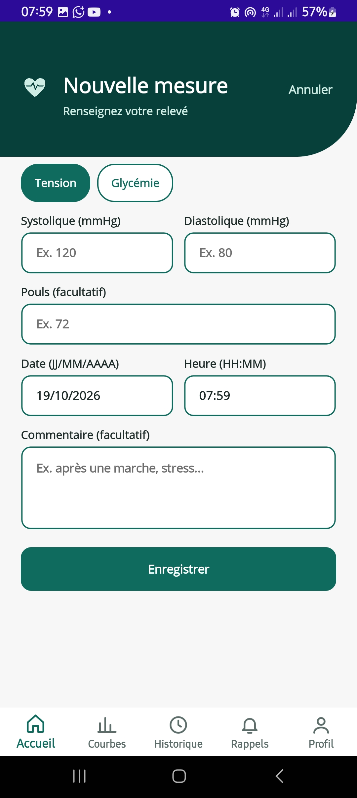
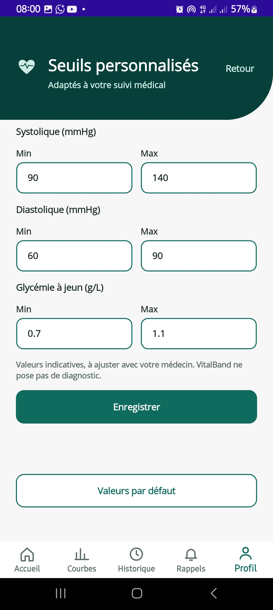
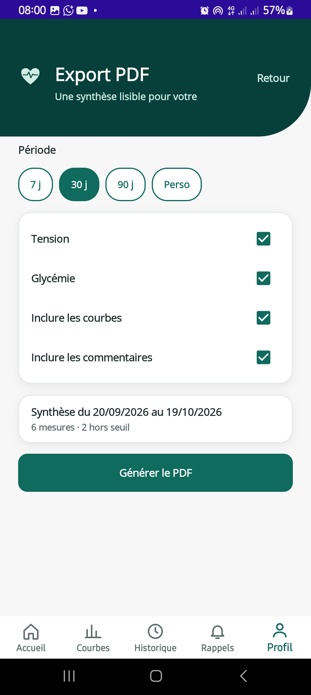
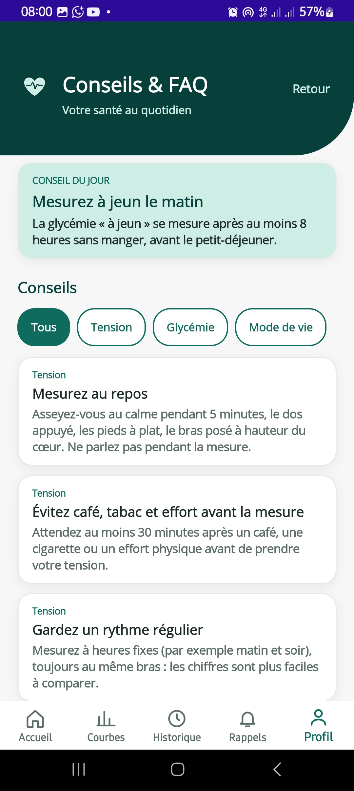

# VitalBand

**Application mobile de suivi de constantes (tension et glycémie)** pour les patients suivis par un médecin : le patient tient un journal de ses mesures et produit une synthèse lisible pour la consultation.

Projet individuel de l'examen pratique de l'**Atelier de développement mobile** (Niveau 5 Génie Logiciel, 2026/2027), réalisé avec **.NET MAUI** (Android), une **API ASP.NET Core** et une base **MySQL**.

**Auteur :** NGLITANG Ruben, GLO5 — ENSPD (École Nationale Supérieure Polytechnique de Douala)

## Fonctionnalités

| Fonctionnalité demandée | Réalisation |
|---|---|
| Saisie de constantes | Tension (systolique, diastolique, pouls) et glycémie (valeur, moment : à jeun / avant / après repas), date et heure, validation des champs |
| Courbes | Courbes sur 7, 30 ou 90 jours, lignes de seuil en pointillés, points hors seuil en orange, moyenne / min / max |
| Seuils personnalisés | Minimum et maximum par constante, valeurs par défaut, état « Normale / Élevée / Basse » et alerte après la saisie |
| Rappels de mesure | Rappels par type, heure et jours de la semaine, activation par interrupteur, notifications Android |
| Commentaires | Commentaire sur chaque mesure, visible dans l'historique et dans le PDF |
| Export PDF | Synthèse A4 (période au choix) : statistiques, courbes, tableau détaillé, partage par e-mail, messagerie, etc. |

**En plus :** comptes utilisateurs (inscription / connexion sécurisée), historique filtrable avec modification et suppression, photo de profil, conseil santé du jour, page Conseils & FAQ, adresse du serveur configurable.

## Architecture

```
Téléphone Android                      PC / serveur
┌──────────────────────┐   HTTP/JSON   ┌────────────────────┐        ┌─────────┐
│ VitalBand.App (MAUI) │ ────────────▶ │ VitalBand.Api      │ ─────▶ │  MySQL  │
│ MVVM, Shell, PDF,    │   JWT         │ ASP.NET Core       │ Dapper │ vitalband│
│ notifications        │               │ (contrôleurs REST) │        └─────────┘
└──────────────────────┘               └────────────────────┘
```

- **App mobile** : .NET MAUI 10 (Android), pattern MVVM avec CommunityToolkit.Mvvm, navigation Shell, courbes dessinées avec Microsoft.Maui.Graphics, PDF créé avec l'API native Android, rappels avec AlarmManager.
- **API** : ASP.NET Core 10, authentification par jeton JWT, mots de passe hachés avec BCrypt, accès MySQL avec Dapper et MySqlConnector.
- **Base de données** : MySQL 8 (`Database/schema.sql`).

```
VitalBand/
├── Database/schema.sql        script de création des tables
├── VitalBand.Api/             API REST (auth, mesures, seuils, rappels)
├── VitalBand.App/             application MAUI
│   ├── Views/                 écrans (XAML)
│   ├── ViewModels/            logique des écrans
│   ├── Services/              appels API, PDF, rappels, photo de profil
│   ├── Models/                modèles de données
│   └── Resources/Raw/health_content.json   conseils et FAQ (modifiable)
└── README.md
```

## Modèle de données

`users` (compte) · `measurements` (type BP/GLYCEMIA, valeurs, date, commentaire) · `thresholds` (min/max par constante et par utilisateur) · `reminders` (type, heure, jours, actif). Les mesures, seuils et rappels sont supprimés avec le compte (`ON DELETE CASCADE`).

## Installation et lancement

### Prérequis

- Windows avec le **SDK .NET 10** et le workload **MAUI** (`dotnet workload install maui-android`)
- **MySQL 8** (serveur et, au choix, MySQL Workbench)
- **JDK 21** et le SDK Android (installés avec le workload ou via Visual Studio / VS Code)
- Un téléphone Android (8.0 ou plus) avec le **débogage USB** activé, ou un émulateur
- `git`, `adb`

### 1. Base de données

Dans MySQL, créez la base et un utilisateur (choisissez votre propre mot de passe) :

```sql
CREATE DATABASE vitalband CHARACTER SET utf8mb4;
CREATE USER 'vitalband'@'localhost' IDENTIFIED BY 'VOTRE_MOT_DE_PASSE';
GRANT ALL PRIVILEGES ON vitalband.* TO 'vitalband'@'localhost';
```

Puis créez les tables :

```bash
mysql -u vitalband -p vitalband < Database/schema.sql
```

### 2. API

Les secrets ne sont **pas** dans le dépôt : ils se configurent avec les *user secrets* de .NET.

```bash
cd VitalBand
dotnet user-secrets set "ConnectionStrings:Default" "Server=localhost;Port=3306;Database=vitalband;User=vitalband;Password=VOTRE_MOT_DE_PASSE" --project VitalBand.Api
dotnet user-secrets set "Jwt:Key" "une-longue-cle-secrete-d-au-moins-32-caracteres" --project VitalBand.Api
dotnet run --project VitalBand.Api --urls http://localhost:5000
```

Vérification : <http://localhost:5000/health> doit répondre `{"status":"ok","users":0}`.

### 3. Application Android

**Option A : téléphone branché en USB (la plus simple)**

```bash
adb devices
adb reverse tcp:5000 tcp:5000
dotnet build VitalBand.App/VitalBand.App.csproj -t:Run -f net10.0-android
```

`adb reverse` permet au téléphone d'atteindre l'API du PC via `localhost:5000` (adresse par défaut de l'application).

**Option B : réseau Wi-Fi**

1. Lancez l'API sur toutes les interfaces : `dotnet run --project VitalBand.Api --urls http://0.0.0.0:5000`
2. Autorisez le port 5000 dans le pare-feu Windows (invite de commandes administrateur) :
   `netsh advfirewall firewall add rule name="VitalBand API" dir=in action=allow protocol=TCP localport=5000`
3. Dans l'application, sur l'écran d'accueil, touchez **« Serveur : … · modifier »** et saisissez l'adresse IP du PC, par exemple `http://192.168.1.10:5000`.

**Option C : APK déjà compilé**

Téléchargez `VitalBand.apk` dans la section **Releases** du dépôt GitHub et installez-le sur le téléphone (autorisez les sources inconnues). L'API doit être lancée comme indiqué ci-dessus, avec l'option A ou B pour que le téléphone la trouve.

### 4. Utilisation

1. Créez un compte (**Commencer > Créer un compte**) puis connectez-vous.
2. Ajoutez des mesures (**+ Nouvelle mesure**) : une alerte s'affiche si la valeur sort de vos seuils.
3. Consultez l'**Historique** et les **Courbes**, réglez vos **Seuils** et vos **Rappels**.
4. Dans **Profil > Export PDF**, générez la synthèse à partager avec le médecin.

Conseils : l'application demande l'autorisation d'envoyer des notifications au premier passage sur l'onglet Rappels.

## API REST

Toutes les routes, sauf `/auth/*` et `/health`, demandent l'en-tête `Authorization: Bearer <jeton>`.

| Méthode | Route | Rôle |
|---|---|---|
| POST | `/auth/register` | Création de compte (renvoie un jeton) |
| POST | `/auth/login` | Connexion (renvoie un jeton) |
| GET | `/measurements?type=&from=&to=` | Liste des mesures (filtres facultatifs) |
| POST / PUT / DELETE | `/measurements`, `/measurements/{id}` | Créer, modifier, supprimer une mesure |
| GET / PUT | `/thresholds` | Lire / enregistrer les seuils |
| GET / POST | `/reminders` | Lister / créer un rappel |
| PUT / DELETE | `/reminders/{id}` | Modifier / supprimer un rappel |
| GET | `/health` | Test de connexion à la base |

## Modifier les conseils et la FAQ

Les conseils santé et les questions fréquentes sont dans `VitalBand.App/Resources/Raw/health_content.json`. Pour en ajouter, copiez un bloc existant et modifiez son texte : aucune modification de code n'est nécessaire. Un conseil différent est affiché chaque jour.

## Choix et limites

- **Sécurité** : mots de passe hachés (BCrypt), jetons JWT valables 7 jours, jeton conservé dans le stockage sécurisé du téléphone, secrets hors du dépôt. La connexion HTTP non chiffrée est utilisée pour le développement local ; un déploiement réel demande HTTPS.
- **Rappels** : programmés avec `AlarmManager` ; Android peut les retarder de quelques minutes pour économiser la batterie. Après un redémarrage du téléphone, ils reprennent à la prochaine ouverture de l'application.
- **Santé** : les seuils par défaut sont indicatifs. VitalBand est un carnet de suivi, il ne pose aucun diagnostic et ne remplace pas l'avis d'un professionnel de santé.
- **Plateformes** : Android uniquement dans cette version.

## Captures d'écran

<table>
  <tr align="center">
    <td><b>Accueil</b><br></td>
    <td><b>Nouvelle mesure</b><br></td>
    <td><b>Historique</b><br></td>
  </tr>
  <tr align="center">
    <td><b>Courbes</b><br></td>
    <td><b>Seuils personnalisés</b><br></td>
    <td><b>Rappels</b><br></td>
  </tr>
  <tr align="center">
    <td><b>Export PDF</b><br></td>
    <td><b>Conseils &amp; FAQ</b><br></td>
    <td><b>Profil</b><br></td>
  </tr>
</table>
